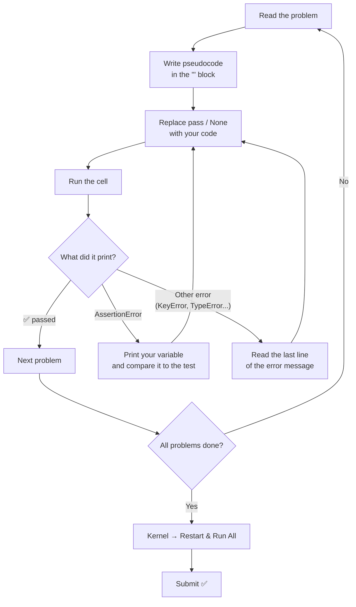
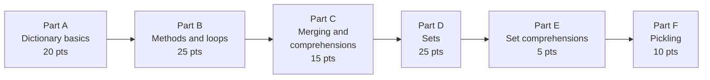
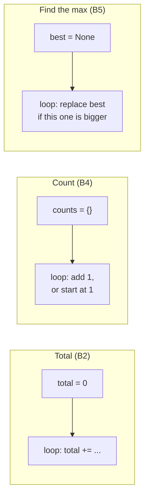
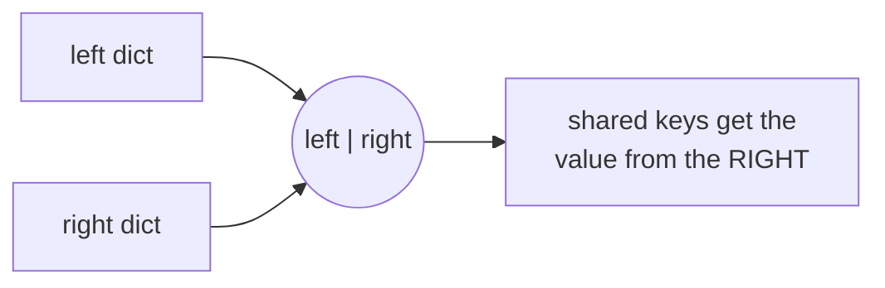
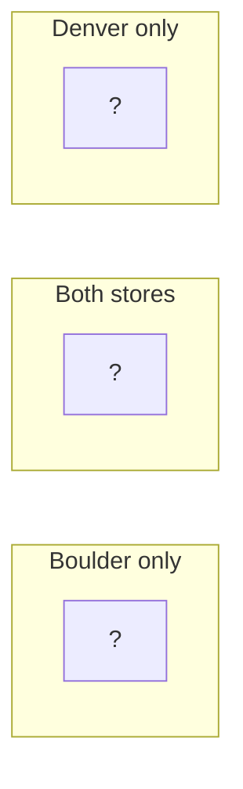
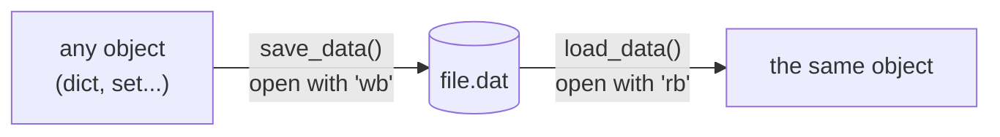

# 📝 Week 9 Homework: Dictionaries and Sets

Notebook: [`Week9_Dictionaries_and_Sets_Homework.ipynb`](Week9_Dictionaries_and_Sets_Homework.ipynb)

This homework practices everything from the Week 9 in-class notebook: dictionaries, sets and pickling. Each problem is a small business task, like a ski shop's prices, a coffee shop receipt, a mailing list or two stores' inventories.

**Total: 100 points + 3 bonus**

---

## How to work through it

1. Open `Week9_Dictionaries_and_Sets_Homework.ipynb` in Jupyter or VS Code and write your name at the top.
2. For each problem, write your **pseudocode** in the `'''` block first.
3. Replace every `pass` and `None` with your own code. **Don't rename the functions** or change the test lines.
4. Run the cell. If it prints `✅`, you're done with that problem. If you get an `AssertionError`, your answer doesn't match yet.
5. When you're finished, run **Kernel → Restart & Run All** and check that every cell still works.

> 💡 An `AssertionError` has no message. Add a `print()` above the tests to see what your code produced, then compare it with the value in the `assert` line.

---

## What's in each part

| Part | Topic | Problems | Points |
|------|-------|----------|--------|
| A | Dictionary basics | A1 Ski Shop Prices, A2 Product Lookup, A3 Catch the KeyError | 20 |
| B | Dictionary methods and loops | B1 Safe Lookups, B2 Receipt, B3 Inventory Report, B4 Word Counter, B5 Top Seller | 25 |
| C | Merging and dictionary comprehensions | C1 Price Update, C2 Comprehensions | 15 |
| D | Sets and set operations | D1 Unique Customers, D2 Mailing List, D3 Store Comparison, D4 Job Requirements | 25 |
| E | Set comprehensions | E1 Email Domains, E2 Big Orders | 5 |
| F | Pickling | F1 `save_data` / `load_data`, F2 bonus question | 10 (+3) |
| | **Total** | | **100 (+3)** |

The parts build on each other, so do them in order.

---

## Part A: Dictionary Basics (20 pts)

| Problem | What you practice | In-class section |
|---|---|---|
| A1 | create a dictionary, look up, add, change, `del`, `len()` | 1–3 |
| A2 | write a function that checks for a key with `in` | 2 |
| A3 | catch a `KeyError` with `try/except` and explain it | 2 |

> ⚠️ In A1, the steps must happen **in order**. The test checks the final dictionary.

---

## Part B: Dictionary Methods and Loops (25 pts)

| Problem | What you practice | In-class section |
|---|---|---|
| B1 | `get(key, default)` | 5 |
| B2 | loop over a list and add up prices from a dictionary, skipping unknown items | 6 |
| B3 | loop over `.items()` with an `if` | 5 |
| B4 | build a dictionary with the **counting pattern** | 4 |
| B5 | find the key with the largest value, **without** `max()` | 6 |

The three loop patterns from class are the ones you need here:

> 💡 B5 asks for a **tuple** `(product, amount)`, not just the product name.

---

## Part C: Merging and Dictionary Comprehensions (15 pts)

| Problem | What you practice | In-class section |
|---|---|---|
| C1 | merge with `\|` (new dictionary) and `\|=` (update in place) | 7 |
| C2 | three one-line dictionary comprehensions: change every value, filter, build from a list | 8 |

Remember which side wins when the same key is in both dictionaries:

> ⚠️ C1's test checks that `current` is **unchanged**, so think about which operator makes a new dictionary.

---

## Part D: Sets and Set Operations (25 pts)

| Problem | What you practice | In-class section |
|---|---|---|
| D1 | remove duplicates with a set, then return a sorted list | 9 |
| D2 | `add`, `update`, `remove`, `discard` in order | 10 |
| D3 | union, intersection, difference, symmetric difference | 12 |
| D4 | subset / superset | 12 |

For D3, sketch where each product goes before you write code:

Then match each variable to the region(s) it covers:

| Variable | Which regions? |
|---|---|
| `both_stores` | the middle |
| `any_store` | all three |
| `boulder_only` | the left |
| `one_store` | the left **and** the right, but not the middle |

> 💡 In D2, one of the removals is for an email that was **never** on the list. Pick the method that doesn't raise an error.

---

## Part E: Set Comprehensions (5 pts)

| Problem | What you practice | In-class section |
|---|---|---|
| E1 | pull out part of each string and keep only unique results | 13 |
| E2 | filter with `if` and transform with `round()` | 13 |

> 💡 `"ana@cu.edu".split("@")` returns `["ana", "cu.edu"]`.

---

## Part F: Pickling (10 pts + 3 bonus)

| Problem | What you practice | In-class section |
|---|---|---|
| F1 | write `save_data` and `load_data` with `pickle.dump` and `pickle.load` | 15 |
| F2 (bonus) | explain why pickling beats a `.txt` file | 15 |

Running Part F creates `contacts.dat` and `tags.dat` in the notebook's folder. That's expected.

---

## Common mistakes

| Mistake | What happens | Fix |
|---|---|---|
| Using `print()` instead of `return` in a function | the test gets `None` and fails | `return` the value |
| Leaving a `None` or `pass` placeholder | `AssertionError` or `TypeError` | replace every placeholder |
| `empty = {}` when you want a set | you get a dictionary | `set()` |
| `d[key]` for a key that might be missing | `KeyError` | `in` or `get()` |
| Running cells out of order | `NameError` or stale values | **Restart & Run All** |
| Opening a pickle file with `"w"` or `"r"` | `TypeError` | `"wb"` / `"rb"` |

---

## ✅ Before you submit

- [ ] Your name is at the top
- [ ] Every `pass` and `None` placeholder is replaced
- [ ] All test cells print ✅
- [ ] A3 and F2 have written answers in the comments
- [ ] **Kernel → Restart & Run All** runs with no errors
