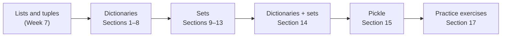
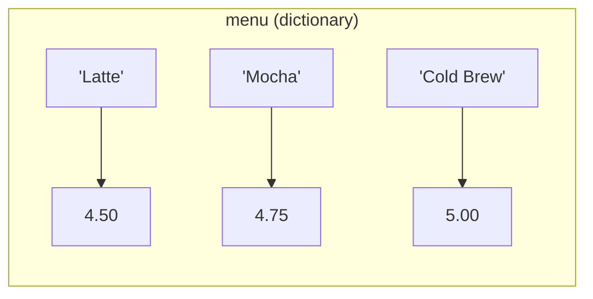
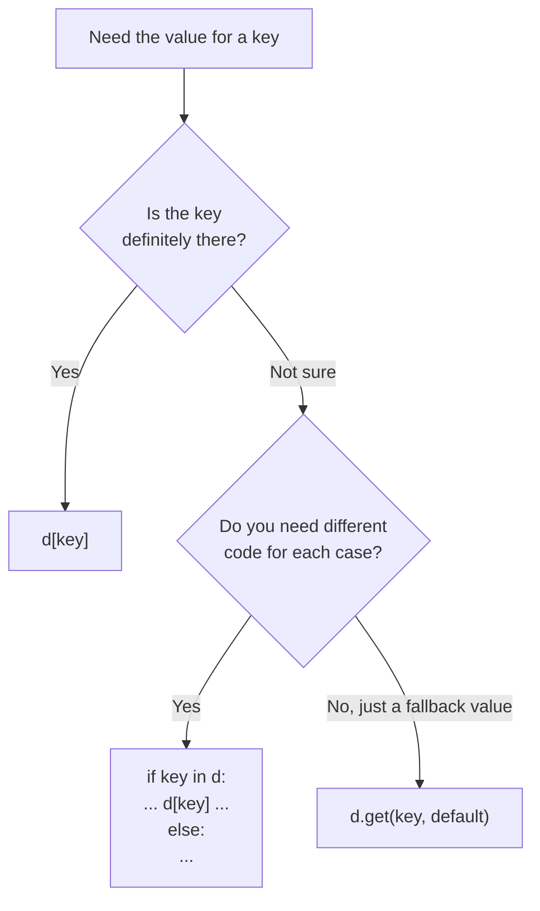
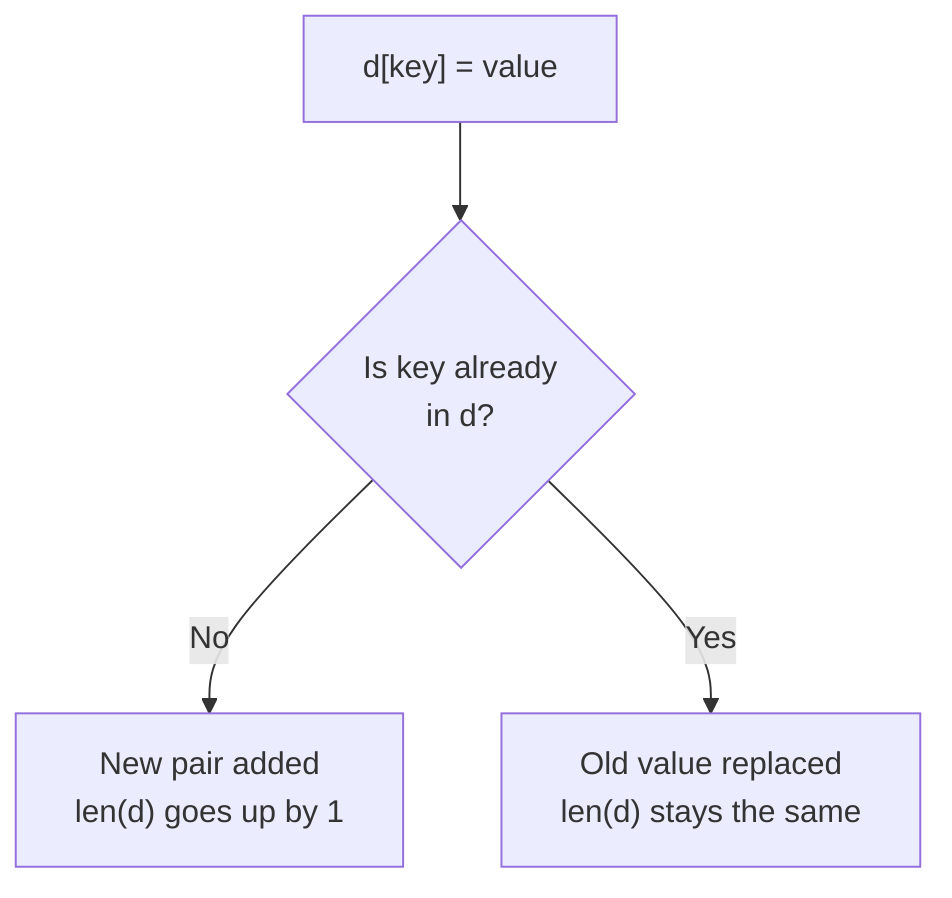
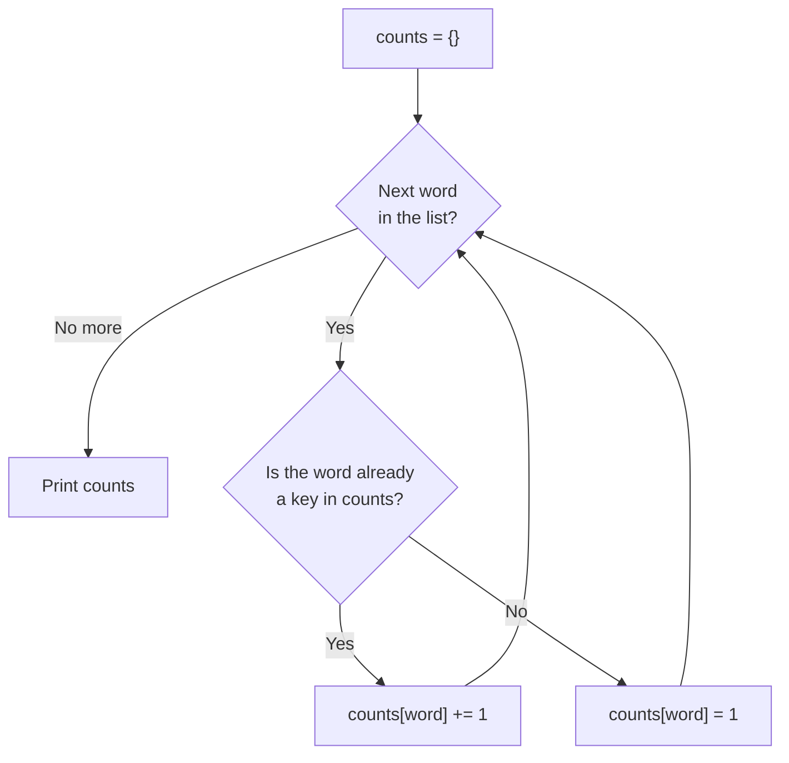
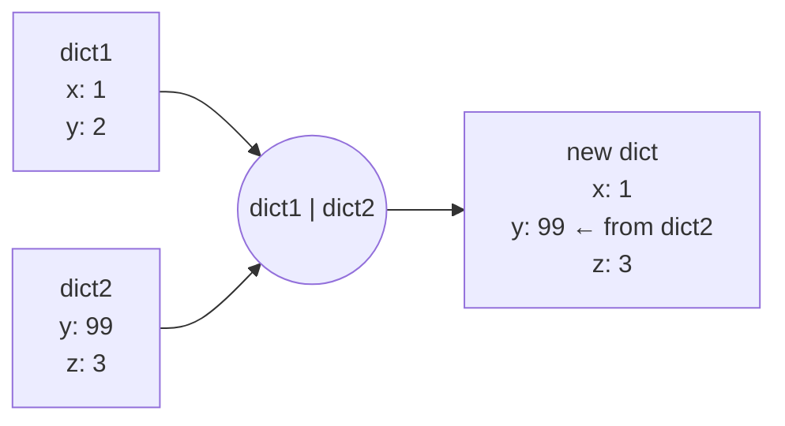
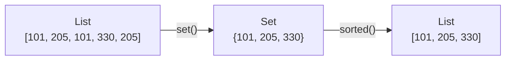
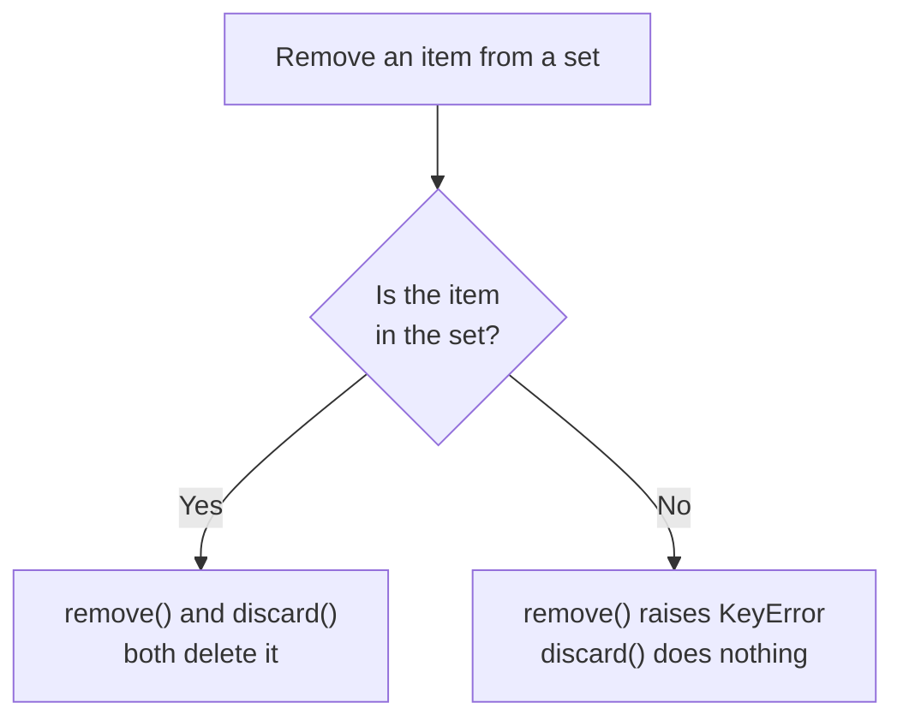
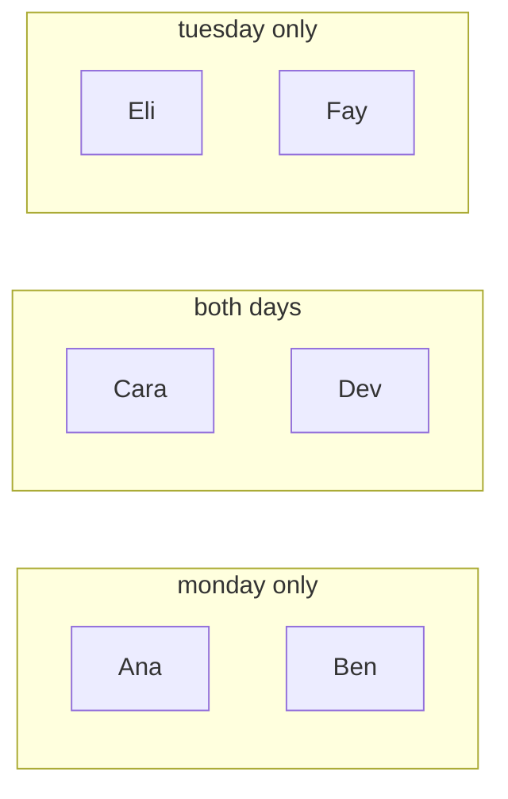
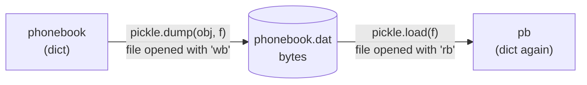

# 📖 Week 9 In-Class: Dictionaries and Sets

Notebook: [`Week9_Dictionaries_and_Sets_InClass.ipynb`](Week9_Dictionaries_and_Sets_InClass.ipynb)

Lists find things by **position** (`cities[2]`). This week we find things by **name**: the price of a *Latte*, the capital of *Texas*, the phone number for *Katie*. That's what a **dictionary** does. We also meet **sets**, which keep only unique items, and **pickle**, which saves Python objects to a file.

By the end of class you should be able to:
- Create dictionaries, then retrieve, add, change and delete key-value pairs
- Avoid `KeyError` with `in` and `get()`
- Loop over a dictionary's keys, values and items
- Merge dictionaries with `|` and `|=`
- Write dictionary and set comprehensions
- Use sets to remove duplicates and compare groups
- Save and load objects with `pickle`

---

## How to run it

1. Open `Week9_Dictionaries_and_Sets_InClass.ipynb` in Jupyter or VS Code.
2. Run the cells **from top to bottom**. Some cells reuse variables (like `menu`) from the cells above them.
3. Section 15 creates two files in the notebook's folder: `phonebook.dat` and `store.dat`.

> 💡 Several cells **cause errors on purpose** (a missing key, removing a missing set item) and catch them with `try/except`, so you can read the error message without the notebook stopping.

---

## The big picture



| # | Section | Key idea |
|---|---|---|
| 1 | What is a dictionary? | `{key: value}` pairs. Keys must be immutable |
| 2 | Retrieving a value | `d[key]`, `KeyError`, checking with `in` |
| 3 | Adding, changing, deleting | `d[key] = value`, `del d[key]`, `len(d)` |
| 4 | Empty dictionaries and loops | `{}` / `dict()`, `for key in d`, counting pattern |
| 5 | Dictionary methods | `get`, `items`, `keys`, `values`, `pop`, `popitem`, `clear` |
| 6 | Common loop patterns | total, update every value, find the max |
| 7 | Merging | `d1 \| d2` and `d1 \|= d2` |
| 8 | Dictionary comprehensions | `{k: v for k, v in d.items() if ...}` |
| 9 | Sets | unique, unordered, `set()` |
| 10 | Adding and removing | `add`, `update`, `remove`, `discard`, `clear` |
| 11 | Loops and `in` with sets | `for item in s`, `x not in s` |
| 12 | Set operations | union, intersection, difference, symmetric difference, subset, superset |
| 13 | Set comprehensions | `{expr for item in seq if ...}` |
| 14 | Dictionaries + sets | common warehouse items, unique languages |
| 15 | Pickle | `pickle.dump` / `pickle.load` |
| 16 | Quick recap | |
| 17 | Practice exercises | three problems to try in class |

---

## Dictionaries: a key points to a value

A dictionary works like a menu board: you look up the **name** (key) to get the **price** (value).



| | List | Dictionary |
|---|---|---|
| Syntax | `["Latte", "Mocha"]` | `{"Latte": 4.50, "Mocha": 4.75}` |
| Look up by | position (index) | key |
| Mutable? | ✅ yes | ✅ yes |
| Duplicates? | allowed | keys are unique |

### Looking up a key safely

Looking up a key that isn't there with `d[key]` crashes with a `KeyError`. There are two safe ways to do it:



> ⚠️ `in` checks the **keys**, not the values. `"Latte" in menu` is `True`, but `4.50 in menu` is `False`.

### Add or change? Same syntax

`d[key] = value` **adds** the pair if the key is new and **changes** the value if the key already exists.



### The counting pattern (Section 4)

This is one of the most useful dictionary patterns. It counts how many times each item appears.



### Three ways to loop

| Loop | You get | Use it when |
|---|---|---|
| `for k in d:` | each key | you need the keys, or want to change `d[k]` |
| `for v in d.values():` | each value | you only care about the values (totals, averages) |
| `for k, v in d.items():` | each `(key, value)` tuple, unpacked | you need both |

### Merging with `|` and `|=` (Section 7)

When a key is in both dictionaries, the **right-hand** dictionary wins.



- `dict3 = dict1 | dict2` makes a **new** dictionary. `dict1` doesn't change.
- `dict1 |= dict2` merges `dict2` **into** `dict1`.

### Dictionary comprehensions (Section 8)

A comprehension builds a whole dictionary in one line. Read it as "**key: value**, for each item, if the condition is true":

```text
{ k : v * 2   for k, v in d.items()   if v > 10 }
  └──┬───┘   └─────────┬───────────┘  └───┬───┘
  result         iteration            filter (optional)
```

| Goal | Comprehension |
|---|---|
| keys from a list | `{item: item ** 2 for item in numbers}` |
| copy a dictionary | `{k: v for k, v in d.items()}` |
| change every value | `{k: v * 0.9 for k, v in d.items()}` |
| keep only some pairs | `{k: v for k, v in d.items() if v > 2000000}` |

---

## Sets: unique items, no order

A set is like a box of items with **no duplicates** and **no positions** (so there's no `s[0]`).



> ⚠️ `{}` makes an empty **dictionary**. Use `set()` for an empty set.

### `remove` vs `discard`



### Set operations (Section 12)

Using `monday = {Ana, Ben, Cara, Dev}` and `tuesday = {Cara, Dev, Eli, Fay}`:



| Operation | Operator | Method | Result for the example |
|---|---|---|---|
| Union (in either) | `a \| b` | `a.union(b)` | Ana, Ben, Cara, Dev, Eli, Fay |
| Intersection (in both) | `a & b` | `a.intersection(b)` | Cara, Dev |
| Difference (in `a`, not `b`) | `a - b` | `a.difference(b)` | Ana, Ben |
| Symmetric difference (in one, not both) | `a ^ b` | `a.symmetric_difference(b)` | Ana, Ben, Eli, Fay |
| Subset (all of `a` is in `b`) | `a <= b` | `a.issubset(b)` | `True` / `False` |
| Superset (`a` has all of `b`) | `a >= b` | `a.issuperset(b)` | `True` / `False` |

### Set comprehensions (Section 13)

Same as a list comprehension, but with curly braces. Any duplicates are dropped automatically.

```python
{e.split("@")[1] for e in emails}   # unique email domains
```

---

## Pickle: saving objects to a file (Section 15)

A `.txt` file only holds text, so you have to convert everything back when you read it. **Pickling** saves the actual Python object as bytes, and unpickling gives you back the same object.



- `"wb"` = write **binary**, `"rb"` = read **binary**. Text mode (`"w"` / `"r"`) won't work.
- You can dump several objects into one file, then load them back **in the same order**.

> ⚠️ Only unpickle files you trust. Loading a pickle can run code.

---

## Practice exercises (Section 17)

| Exercise | What you practice |
|---|---|
| 1. State Capitals Quiz | creating a dictionary, `input()`, `in`, looping with `.items()` |
| 2. Semester Grades | building a dictionary of lists, a comprehension with a filter |
| 3. Course Overlap | removing duplicates, `&`, `^`, `\|`, `sorted()` |

Write the pseudocode in the `'''` block first, then the code.

---

## Common mistakes

| Mistake | What happens | Fix |
|---|---|---|
| `d["Americano"]` when the key isn't there | `KeyError` | check with `in`, or use `d.get(key, default)` |
| `4.50 in menu` to check a price | `False`, because `in` checks keys | `4.50 in menu.values()` |
| `empty = {}` for a set | you get a dictionary | `empty = set()` |
| `my_set[0]` | `TypeError`: sets have no index | loop over it, or `sorted(my_set)[0]` |
| `s.remove(x)` when `x` is missing | `KeyError` | `s.discard(x)` |
| a list as a dictionary key | `TypeError: unhashable type` | use a tuple |
| `open("data.dat", "w")` for pickle | `TypeError` | use `"wb"` and `"rb"` |
